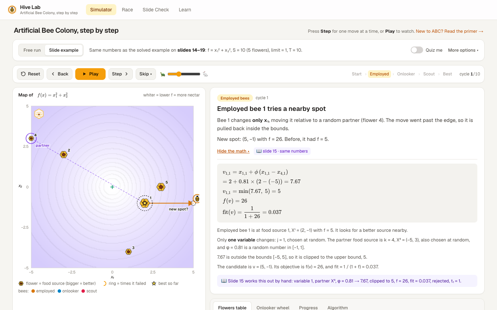
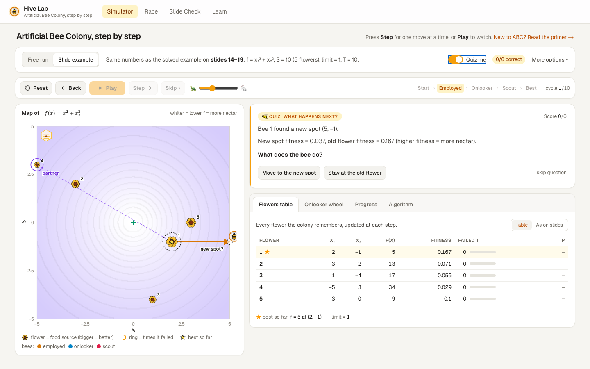
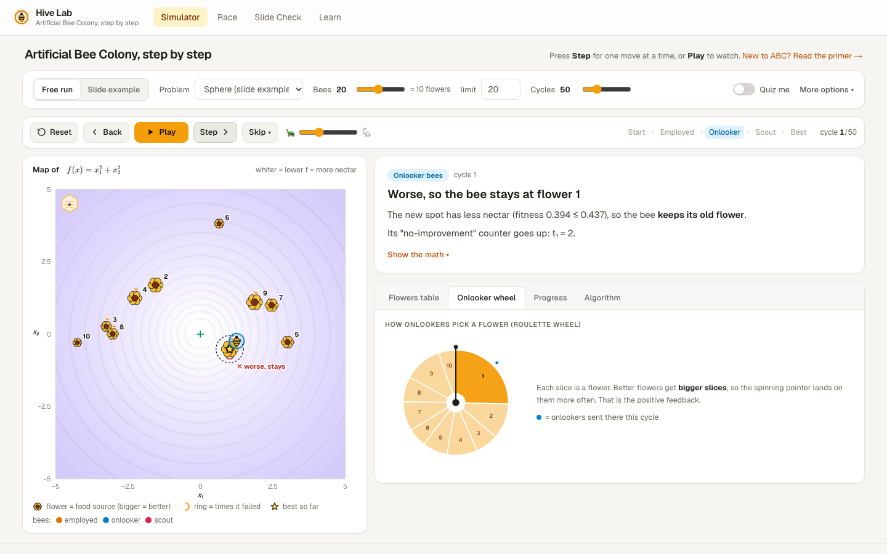
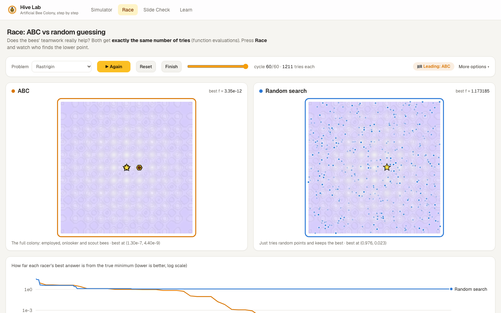
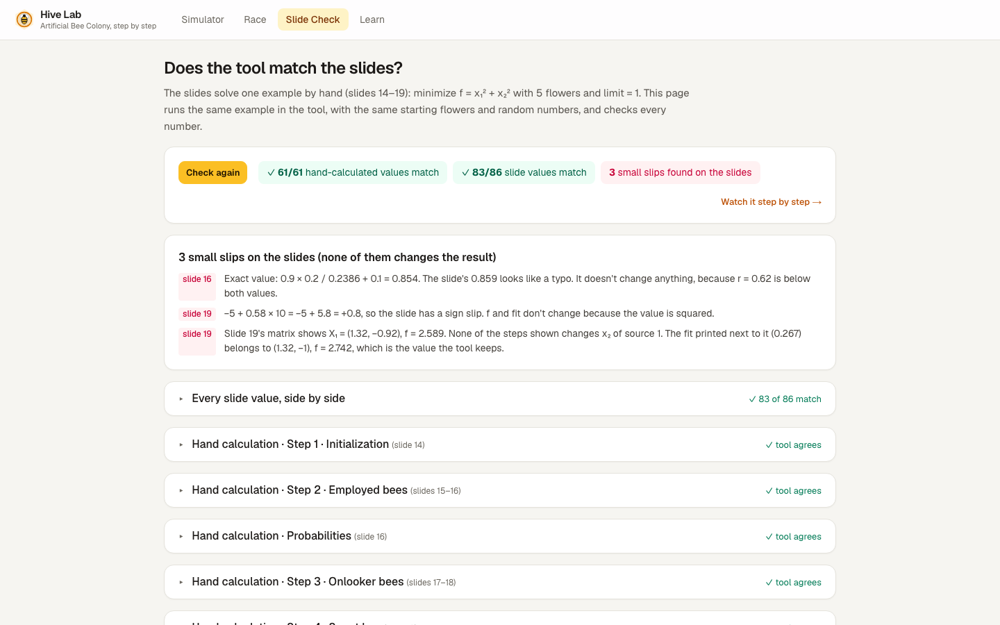

# 🐝 Hive Lab: the Artificial Bee Colony algorithm, step by step

An interactive, browser-based tool that **teaches the Artificial Bee Colony (ABC) optimization algorithm**
(Karaboga, 2005). It is a VisuAlgo-style stepper with live math, a predict-the-next-step quiz, a roulette wheel for
onlooker selection, and an ABC vs random search race. Every number in the course's solved example is reproduced
and checked against a hand calculation.

**Live demo:** https://jamvi08.github.io/abc-hive-lab/

**Demo video (3–5 min):** _add your YouTube / Drive link here_



---

## What it does

| Requirement | How Hive Lab covers it |
| --- | --- |
| **Pick a problem, change parameters** | One slim settings strip: problem (6 built-in 2-D problems, including the slide's x₁² + x₂², plus *Your own function…*), number of bees **S** (Np = S/2 flowers), **limit** (auto = Np × D, as the slides suggest) and **cycles T**. Less common settings (onlooker rule, seed, trails, quiz question types) sit under *More options*. |
| **Play / pause / step / reset, state at every step** | Reset, Back, **Play/Pause**, **Step**, a *Skip* menu (next phase, next cycle, end) and a speed slider. Keyboard: `Space` `→` `←` `N` `C` `R`. The *Flowers table* tab shows every food source's x, f, fitness, failure counter t and p at every step, either as a table or *as on slides* (matrices). Changed cells flash. |
| **Visualize + plain-language explanation** | A light contour map of f with food sources drawn as flowers (bigger = more nectar, ring = how many times it failed). A bee flies to wherever the action is. Each step gets a **one- or two-sentence explanation in plain words**. *Show the math* reveals the formula with the real numbers filled in, plus the matching slide. Tabs show the onlooker wheel, a progress chart and the slide-7 pseudocode with the current line highlighted. |
| **Checked against a hand calculation / textbook example** | **Slide example** mode replays the solved example on slides 14–19 with the same starting flowers and random numbers. The **Slide Check** page compares 86 slide values and 61 independently hand-calculated values with the engine. The same checks run as **168 unit tests**. |

### Something new (beyond VisuAlgo)

1. **"Quiz me" mode.** Before each greedy selection, onlooker choice or scout check, the tool asks what will
   happen ("New spot fitness 0.037, old flower 0.167: move or stay?"). It can also ask you to calculate the new spot
   by hand. Your answer is scored, then the step is revealed.
2. **Onlooker wheel.** The slides' rule (visit sources in turn, recruit if `r < p_m`) is drawn as a *rose*: each
   petal's length is p_m and the random r is drawn as an arc. The alternative roulette-wheel rule (`p_m / Σp`)
   is drawn as a spinning wheel. Blue dots count the onlookers recruited this cycle, which shows the positive feedback.
3. **ABC vs random search race.** Same problem, **same number of tries (function evaluations)**, side by side,
   with a convergence chart. Under *More options* you can add racers without scouts or without onlookers to see what
   each phase contributes, then **repeat the race 30 times**. For example, on Rastrigin, ABC beats random search in 30/30
   races.
4. **Slide check.** The slides' numbers are reproduced *and audited*. The tool flags three small slips in the
   slides and explains each one (see below).

| Quiz | Onlooker wheel | Race | Slide check |
| --- | --- | --- | --- |
|  |  |  |  |

---

## The algorithm as implemented (follows the course slides)

```
Initialization Phase            x_mi = l_i + rand(0,1)·(u_i − l_i),  t_m = 0
REPEAT
  Employed Bees Phase           for each source m: pick variable i, partner k ≠ m, φ ∈ [−1, 1]
                                v_mi = x_mi + φ·(x_mi − x_ki)   (clip to bounds)
                                greedy: if fit(v) > fit(x_m) then x_m ← v, t_m = 0 else t_m += 1
  p_m = 0.9·fit_m / max(fit) + 0.1
  Onlooker Bees Phase           until Np onlookers are placed: visit sources in turn, recruit if r < p_m
                                (or: roulette wheel p_m / Σp), then search + greedy as above
  Scout Bees Phase              every source with t_m > limit: store it in memory B, replace by a random source
  Memorize the best solution achieved so far
UNTIL cycle = MCN (T)
```

- Fitness for minimization: `fit = 1/(1+f)` if `f ≥ 0`, else `1 + |f|` (slide 10).
- Colony size S, with **Np = S/2** food sources = employed bees = onlooker bees (slide 14).
- The default `limit` is **Np × D**. The slides say "ideally limit = Np × #decision variables".
- One function evaluation per candidate, so a cycle costs `2·Np + (#scouts)` evaluations.

## Verification against the slides' solved example

`Minimize f(x) = x₁² + x₂²,  −5 ≤ x₁, x₂ ≤ 5,  S = 10, Np = 5, T = 10, limit = 1` (slides 14–19).

The slides print the random numbers for source 1 (employed and onlooker phases) and for the scout. For the other
bees, the random numbers were **back-calculated so that the slides' matrices are reproduced exactly**. They are
labelled as back-calculated everywhere in the tool. With these numbers, every matrix on slides 16, 18 and 19
comes out identical.

Result: **80 exact matches, 3 rounding-only differences, 61/61 hand-calculated values reproduced** (to 9 decimals).
The three places where the slides differ from the arithmetic:

| Slide | Printed | Correct | Why it doesn't change anything |
| --- | --- | --- | --- |
| 16 | p₂ = 0.859 | 0.9 × 0.2 / 0.2386 + 0.1 = **0.854** | r = 0.62 is below both, so the onlooker is still recruited |
| 19 | X_new⁵·² = −0.8 | −5 + 0.58 × 10 = **+0.8** | f = 1.13 and fit = 0.469 are the same, because the value is squared |
| 19 | X¹ = (1.32, −0.92), f = 2.589 | (1.32, −1), f = 2.742 | no step on the slides changes x₁,₂; the fit printed beside it (0.267) belongs to (1.32, −1) |

Rounding-only: fit₄ = 1/35 = 0.0286 (slide 0.028), p₅ = 0.4771 (slide 0.476), f₄ = 24.3728 (slide 24.38).

## Run it locally

```bash
npm install
npm run dev        # http://localhost:3000
npm test           # 168 tests: slide values, hand calculation, algorithm properties
npm run build      # static export to ./out
```

Requires Node.js 20.9+.

### Re-record the demo video

`demo/SCRIPT.md` is the timed narration. `demo/record-demo.mjs` drives the app through exactly those beats and writes a
silent MP4 that you can voice over:

```bash
npm run build && (cd out && python3 -m http.server 4173) &
npx playwright install chromium          # once
node demo/record-demo.mjs http://localhost:4173 demo/hive-lab-demo.mp4   # needs ffmpeg
```

## Project structure

```
src/lib/abc/
  engine.ts        ABC as a step generator: every decision is one explainable step with a full snapshot
  random.ts        seeded PRNG + scripted RNG that replays the slides' random numbers
  problems.ts      benchmark problems + fitness function
  expr.ts          safe expression compiler for custom functions (no eval)
  textbook.ts      the slide example: population, random numbers, 86 slide checks
  handcalc.ts      the independent hand calculation (61 values)
  explain.ts       plain-language explanation + formula with numbers for every step
  quiz.ts          predict-the-next-step questions
  randomSearch.ts  baseline for the race
  __tests__/       vitest suites
src/components/
  sim/             simulator: search space, controls, explanation, pseudocode, state table, wheel, quiz
  race/            ABC vs random search
  verify/          textbook check page
src/app/           routes: / (simulator), /race, /verify (slide check), /learn
demo/              demo video narration script + automated screen-recording script
```

## Tech

Next.js 16 (App Router, static export) · React 19 · TypeScript · Tailwind CSS 4 · KaTeX · Vitest. There is no chart
library: all visuals are hand-built SVG. Deployed on GitHub Pages by `.github/workflows/deploy.yml`, which runs the
tests before every deploy.

## References

- D. Karaboga, *An idea based on honey bee swarm for numerical optimization*, Technical Report TR06, Erciyes University, 2005.
- Course slides: *4.3 Artificial Bee Colony Optimization Algorithm*: theory (slides 2–12) and solved example (slides 14–19).
- Inspiration for the stepping UI: [VisuAlgo](https://visualgo.net/en/).
